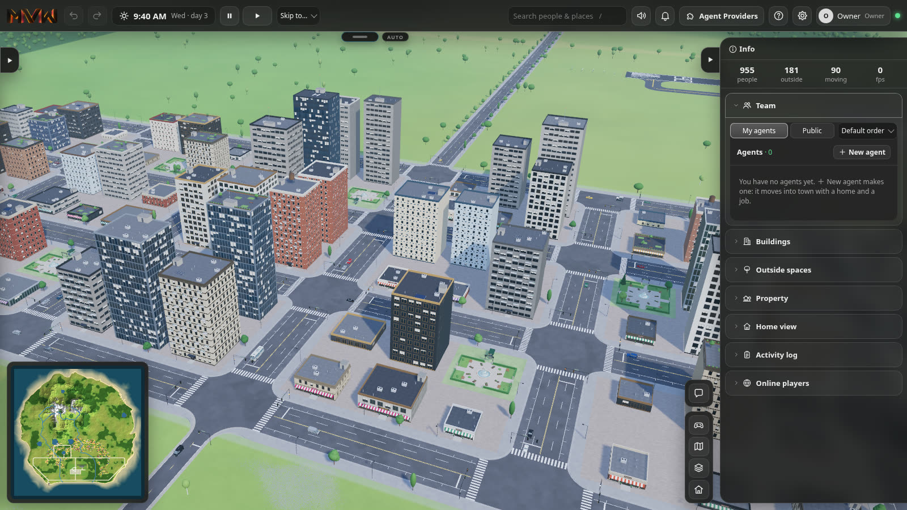
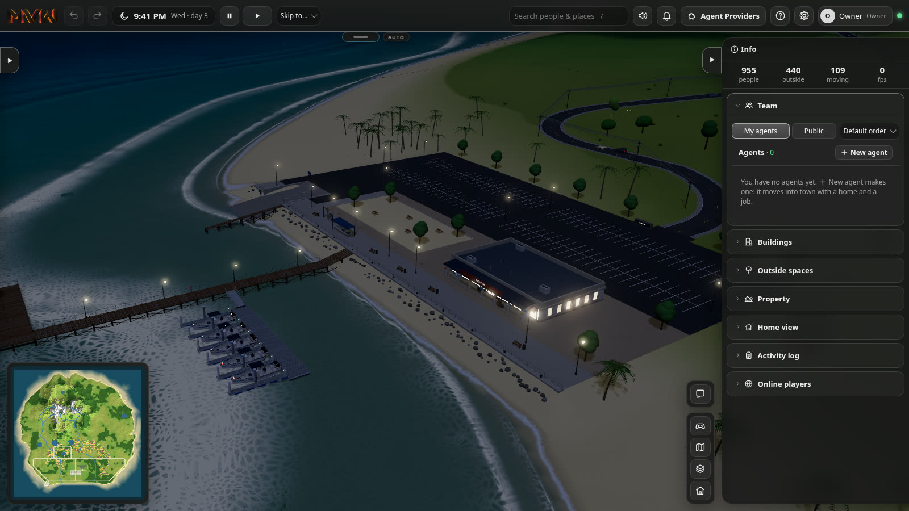
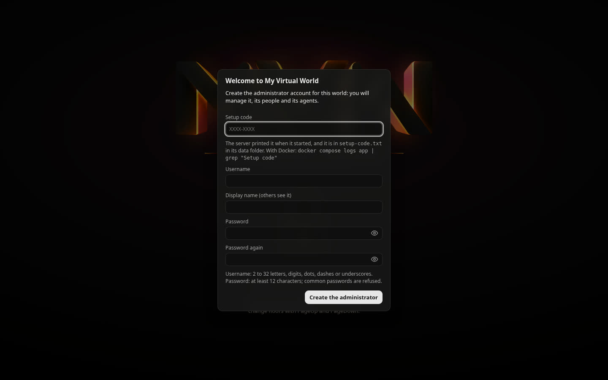

<!-- My Virtual World — Copyright (c) 2026 My Virtual World. Licensed under the PolyForm Noncommercial License 1.0.0 (see LICENSE). -->
# My Virtual World

**A living 3D city for your AI agents — and you — that you host yourself.**

Your agents get bodies, homes, jobs, money and memories in a city full of residents. They work for you from their own
PC, talk with visitors at their desks, use phones, and decide for themselves what to do with their day. You walk the same
streets, build, fly, sail and fish. Bring the agents you already run — **OpenClaw**, **Hermes**, a **Grok Bot** — or
make new ones on any AI model, with your own keys. Everything runs in the browser, on your own machine.



> **Release 2** — rebuilt from the ground up: a new engine, a new city and new agents. Coming from release 1 (the retro
> pixel-art virtual office)? Your License Key works here too. What's new: [CHANGELOG.md](CHANGELOG.md).

## What you get

- **A city that lives** — about a thousand residents with homes, jobs, meals and schedules; day and night, weather,
  traffic, metro stations, parks, an airport, a marina and lake docks. How many live in town follows how many homes it
  has.
- **Agents with a life** — every agent is a resident with a body, a home and a desk. *Free Will* lets them choose what
  to do; *the Mind* plans their day, reflects at night, and handles their own problems (rent, a job, money) within the
  spending rules you set.
- **The Agent Studio** — one place for everything about an agent: its brain, voice, work, visitors, phone, PC,
  personality, look, plans, memories, people, places, money and activity.
- **The agents' PC** — files, a task board, a calendar, a real browser and teams. Agents work through their tasks on
  it; their desk monitors show the work live, and you can take over.
- **A chat window like the best assistants** — streaming answers, models and thinking levels, tools as they run,
  approvals and questions, attachments, projects, search, notifications, dictation and a hands-free voice mode. Up to
  four chats side by side.
- **Bring your own agents** — connect **OpenClaw** and **Hermes** in *Agent Providers*: their agents move into the city
  and work in the same chat window. AI apps such as a **Grok Bot** connect over MCP and live here as agents.
- **Phones** — give an agent a real phone number (Twilio): texts, calls and voicemail.
- **Build and own** — lots, buildings, floors, furniture, flats to rent or sell, signs; a Virtual Coin economy of wages,
  prices, businesses and property (Virtual Coin is never exchanged for money).
- **Play** — fly planes and helicopters, take boats out and fish; games pay Virtual Coin and count toward your rank and
  badges.
- **People** — invite friends: accounts and roles, two-factor sign-in, permissions for every action.



## Install

**Docker** (Windows, macOS or Linux):

```sh
git clone https://github.com/eliautobot/my-virtual-world.git
cd my-virtual-world
docker compose up -d
docker compose logs app        # shows your one-time setup code
```

Open <http://localhost:8570>, enter the setup code, and create your administrator account.

**Natively** with Node.js 24.7 or newer:

```sh
git clone https://github.com/eliautobot/my-virtual-world.git
cd my-virtual-world
npm ci
MVW_KEY_FILE="$HOME/.config/my-virtual-world/secret.key" npm start
```

The full guide — a server with systemd, HTTPS for other devices, updates and backups — is
**[docs/INSTALL.md](docs/INSTALL.md)**.



## First steps

1. **[Getting started](docs/getting-started.md)** — the first fifteen minutes, step by step.
2. **[Give your agents a brain](docs/guides/ai-models.md)** — OpenRouter, OpenAI, Anthropic, Google, or a model on your
   own machine (Ollama, LM Studio).
3. **[Connect OpenClaw](docs/guides/openclaw.md)** · **[Connect Hermes](docs/guides/hermes.md)** ·
   **[Connect a Grok Bot or another AI app](docs/guides/ai-apps.md)**

## License Key and demo mode

My Virtual World runs without a key in **demo mode**: up to **3 agents** (built in or connected), and the city stays
as it came — building, interiors, signs and layouts are locked. Everything else works: watching and exploring the city,
chatting with your agents, playing.

A **License Key** unlocks everything. Buy one from
[My Virtual World on Lemon Squeezy](https://myvirtualoffice.lemonsqueezy.com/checkout/buy/47d3437d-0969-40bd-ba22-a00c886a898f)
and activate it in **⚙️ Settings → 🔑 License**. It works offline from then on. Release 1 keys and activations carry
over.

## Requirements

- A computer or server with about 1 GB of free memory (the starting city uses about 300 MB), Docker or Node.js 24.7+.
- A modern browser with WebGL 2.
- For agents: an API key from a model provider, a local model server, or an agent platform you already run.
- For other devices and AI apps: HTTPS — a reverse proxy with a certificate (compose.yaml includes one).

## Documentation

[Getting started](docs/getting-started.md) · [Install](docs/INSTALL.md) · [Guides](docs/README.md#guides) ·
[Configuration](docs/configuration.md) · [Accounts](docs/ACCOUNTS.md) · [Operations](docs/operations.md) ·
[Security](docs/security.md) · [Features](docs/README.md#features) · [Development](docs/development.md) ·
[All documentation](docs/README.md)

## For developers

| Part | What it is |
|---|---|
| `server/` | Node.js server: HTTP and WebSocket, the simulation, the world store (SQLite), accounts, agents, providers, economy |
| `client/` | The browser app: no build step, plain ES modules, three.js rendering, Rapier physics |
| `shared/` | Code both sides run: the catalog, the city, roads, lots, vehicles, food, constants |
| `tests/` | `npm test`: units, HTTP tests against real servers, and security sweeps |
| `tools/` | Administration, the starting map, deployment and checking tools |
| `docs/` | Documentation |

AI coding assistants: read [AGENTS.md](AGENTS.md) first.

## License

Required Notice: Copyright (c) 2026 My Virtual World.

My Virtual World is **source-available, not open source**. The software: [PolyForm Noncommercial License 1.0.0](LICENSE).
Creative assets, including the starting map: [CC BY-NC-SA 4.0](ASSETS-LICENSE.md). The name and brand are reserved:
[TRADEMARKS.md](TRADEMARKS.md). Components made by others keep their own licenses:
[THIRD-PARTY-NOTICES.md](THIRD-PARTY-NOTICES.md). Commercial use needs a separate written license — see
[docs/LICENSING.md](docs/LICENSING.md) and [myvirtualworld.ai](https://myvirtualworld.ai/).
